<!--
  Visual system: https://walidmoustafa2077.github.io (2026)
    bg #0A0705 · panel #15100B · paper #F4ECE2 · muted #AB9D8F · dim #8B7D71 · accent #FF5A1F
    Playfair-style serif display · Inter UI · IBM Plex Mono labels
  The banner and diagram ship in dark and light variants; <picture> picks the one that matches the page.
  Icons are Font Awesome Free 6.7.2 (CC BY 4.0 — fontawesome.com/license/free),
  recolored to accent (#FF5A1F) and muted (#8B7D71): assets/icons/<icon>-accent.svg / <icon>-muted.svg
-->

<picture>
  <source media="(prefers-color-scheme: dark)" srcset="assets/header-dark.svg">
  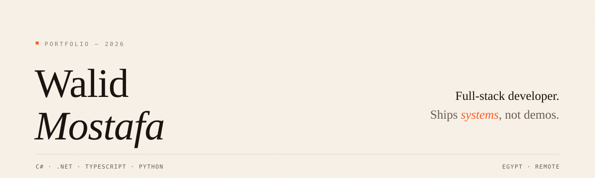
</picture>

<a href="https://walidmoustafa2077.github.io">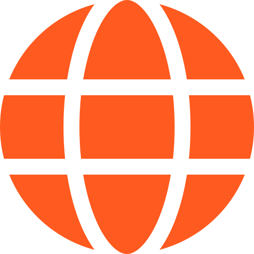&nbsp;Portfolio</a>
&nbsp;&nbsp;·&nbsp;&nbsp;
<a href="https://github.com/walidmoustafa2077">&nbsp;GitHub</a>
&nbsp;&nbsp;·&nbsp;&nbsp;
<a href="https://linkedin.com/in/walidmostafa77">&nbsp;LinkedIn</a>
&nbsp;&nbsp;·&nbsp;&nbsp;
<a href="mailto:walidmostafa2077@gmail.com">&nbsp;Email</a>
&nbsp;&nbsp;·&nbsp;&nbsp;
<a href="https://stackoverflow.com/users/walid-mostafa">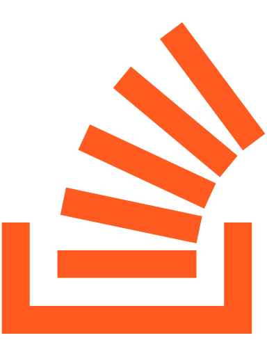&nbsp;Stack Overflow</a>

<a href="#-about">About</a> &nbsp;·&nbsp;
<a href="#-featured-work">Work</a> &nbsp;·&nbsp;
<a href="#-document-vision-pipeline">Pipeline</a> &nbsp;·&nbsp;
<a href="#-also-building">More</a> &nbsp;·&nbsp;
<a href="#-tech-stack">Stack</a> &nbsp;·&nbsp;
<a href="#-github-stats">Stats</a>

## 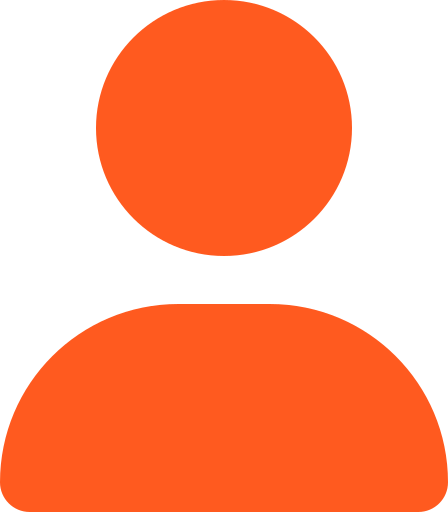&nbsp; About

I build the parts of a product that never make it to the landing page: **auth, payments, migrations, deploys**. Backend first, in C# and Python. I keep scope small enough to finish and tests honest enough to trust, then ship the thing.

The typing got faster. The judgement stayed mine.

> **Read the diff. Ship the system.**

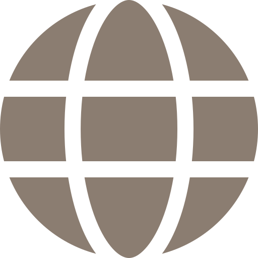&nbsp; Egypt, remote &nbsp;·&nbsp; open to backend and full-stack work &nbsp;·&nbsp; BSc in Business Information Systems

## 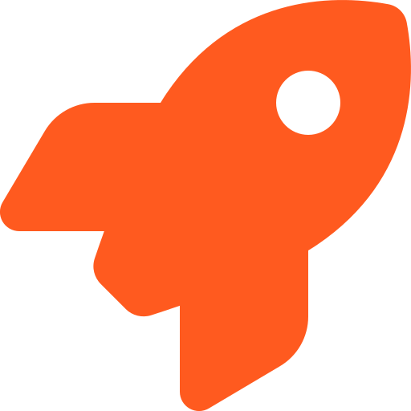&nbsp; Featured Work

<table>
<tr>
<td width="50%" valign="top">

### &nbsp; Document Vision

Small, focused models that turn a **phone photo into a clean scan**: detect → dewarp → remove shadows → export.

`PyTorch` `ONNX` `.NET` `Blender`

[PaperMask](https://github.com/walidmoustafa2077/PaperMask) · [Details below ↓](#-document-vision-pipeline)

</td>
<td width="50%" valign="top">

### 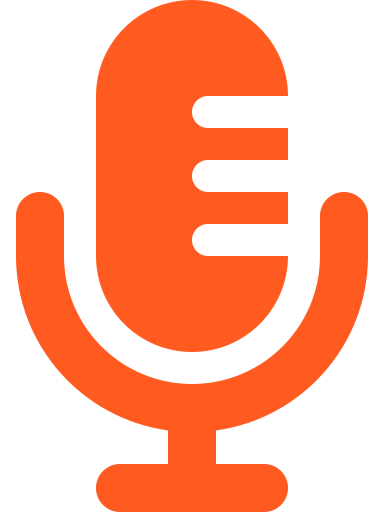&nbsp; Voice Agent

A local phone-call loop you can **interrupt mid-sentence**. Barge-in at ~250 ms, audio never leaves the machine.

`Silero VAD` `Zipformer` `Ollama` `SignalR`

[Source](https://github.com/walidmoustafa2077/voice-agent)

</td>
</tr>
<tr>
<td width="50%" valign="top">

### &nbsp; NexaPOS

Retail point of sale: a **.NET 9 API** (products, sales, carts, inventory) and a **WPF counter client**. JWT auth with Admin, Manager, and Cashier roles.

`ASP.NET Core` `EF Core` `WPF` `MVVM`

Private

</td>
<td width="50%" valign="top">

### &nbsp; Tathkīr

Windows prayer companion: multi-location times, Hijri calendar, tray widget, athkar, and Qur'an with **100+ reciters**. RTL, localization, dynamic theming.

`WPF` `HttpClient` `Docker` `ASP.NET Core`

[Source](https://github.com/walidmoustafa2077/Tathkir)

</td>
</tr>
<tr>
<td colspan="2" valign="top">

### &nbsp; NexaCV (private)

Subscription CV builder where the boring parts are the product: **Paddle billing** (checkout, webhooks, customer portal, subscription sync), ATS-friendly exports, a documented design system, and **Playwright** coverage across the Next.js app.

`Next.js` `Paddle` `Playwright`

</td>
</tr>
</table>

## &nbsp; Document Vision Pipeline

  <picture>
    <source media="(prefers-color-scheme: dark)" srcset="assets/pipeline-dark.svg">
    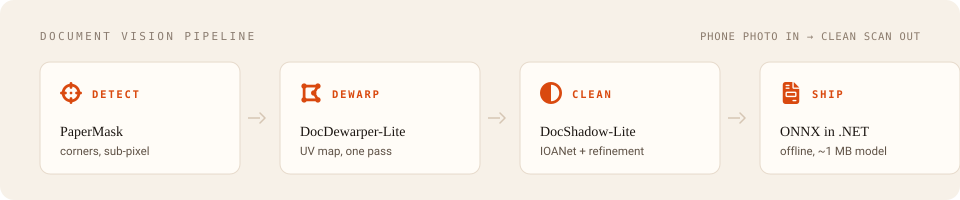
  </picture>

Each stage is a **small model with one job**, exported to ONNX so the .NET app can run it offline. The hard part is never the architecture — it is the data, so the training pipeline is part of the product.

<table>
  <tr>
    <th width="118" align="left">Stage</th>
    <th width="220" align="left">Project</th>
    <th align="left">What it does</th>
  </tr>
  <tr>
    <td>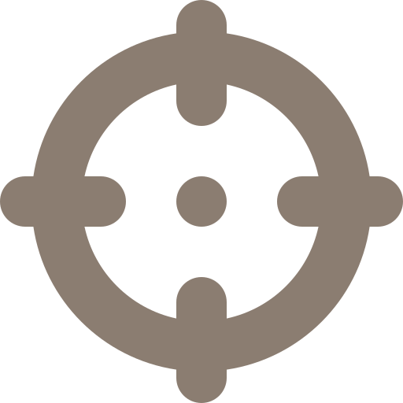&nbsp; <b>Detect</b></td>
    <td><a href="https://github.com/walidmoustafa2077/PaperMask"><b>PaperMask</b></a></td>
    <td>MobileNetV3-Small + Lite-FPN, heatmap head with sub-pixel offsets, exported to ONNX (~1 MB) for .NET</td>
  </tr>
  <tr>
    <td>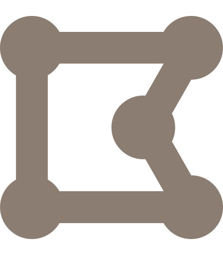&nbsp; <b>Dewarp</b></td>
    <td><a href="https://github.com/walidmoustafa2077/DocDewarper-Lite"><b>DocDewarper-Lite</b></a></td>
    <td>UVDoc fine-tuned on NexaDoc 50K, with a Kaggle 2×T4 training notebook</td>
  </tr>
  <tr>
    <td>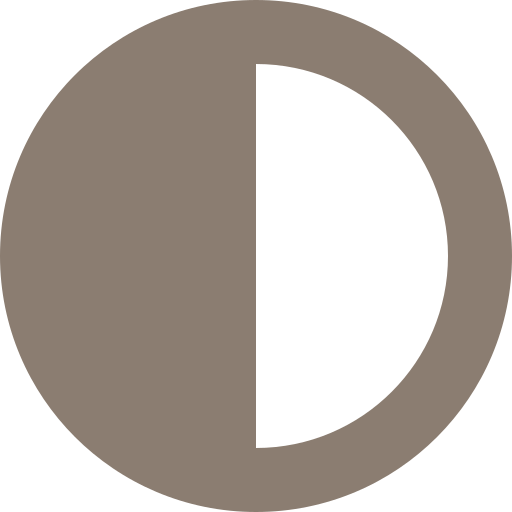&nbsp; <b>Clean</b></td>
    <td><a href="https://github.com/walidmoustafa2077/DocShadow-Lite"><b>DocShadow-Lite</b></a></td>
    <td>Two-stage shadow removal: IOANet, then Laplacian-pyramid refinement</td>
  </tr>
  <tr>
    <td>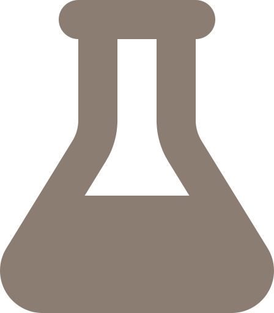&nbsp; <b>Data</b></td>
    <td><a href="https://github.com/walidmoustafa2077/Doc-Dataset-Generate"><b>Doc-Dataset-Generate</b></a></td>
    <td>SynDoc_Wild: synthetic shadows, camera degradation, perspective warp, plus a photorealistic Blender 4.2 pipeline</td>
  </tr>
  <tr>
    <td>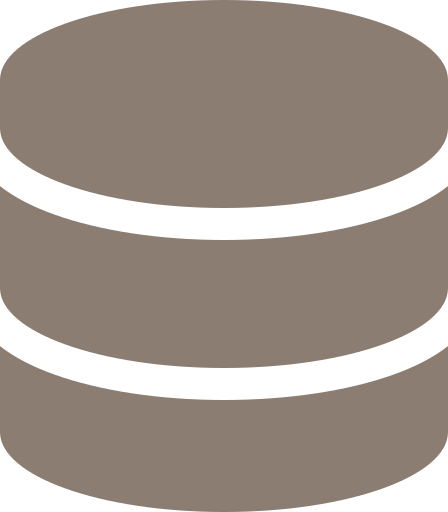&nbsp; <b>Dataset</b></td>
    <td><b>NexaDoc 50K</b></td>
    <td>Published on Kaggle, the dataset behind the dewarping work</td>
  </tr>
</table>

## &nbsp; Also Building

<table>
  <tr>
    <th width="170" align="left">Project</th>
    <th width="170" align="left">Stack</th>
    <th align="left">What it is</th>
  </tr>
  <tr>
    <td><a href="https://github.com/walidmoustafa2077/let-me-code"><b>let-me-code</b></a></td>
    <td><code>Node.js</code> <code>MCP</code></td>
    <td>Agent factory for opencode: specialised subagents, workflow skills, and a delegation MCP server, installed with one command</td>
  </tr>
  <tr>
    <td><a href="https://github.com/walidmoustafa2077/termyx"><b>termyx</b></a></td>
    <td><code>Rust</code></td>
    <td>Native terminal with first-class RTL support</td>
  </tr>
  <tr>
    <td><a href="https://github.com/walidmoustafa2077/RecycleBinTray"><b>RecycleBinTray</b></a></td>
    <td><code>C#</code> <code>Win32</code></td>
    <td>Windows tray monitor: live item count and size, open or empty from a native menu</td>
  </tr>
  <tr>
    <td><a href="https://github.com/walidmoustafa2077/tasks-lite"><b>tasks-lite</b></a></td>
    <td><code>Node.js</code> <code>JWT</code></td>
    <td>Task API with validation, clean errors, and Swagger docs</td>
  </tr>
  <tr>
    <td><b>store-system</b> (private)</td>
    <td><code>ASP.NET Core</code> <code>SQL Server</code></td>
    <td>Retail back office plus public storefront in one codebase: terminal, inventory, shifts, wallets, Paymob checkout</td>
  </tr>
</table>

## 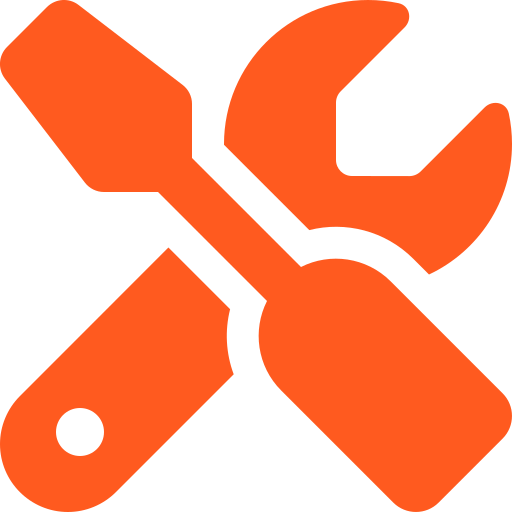&nbsp; Tech Stack

<b>Languages</b> — C# · Python · TypeScript · JavaScript · Rust · SQL 
<b>Backend</b> — ASP.NET Core · .NET 9 / 10 · EF Core · Minimal APIs · SignalR 
<b>Frontend</b> — React · Next.js · Tailwind · WPF (MVVM) 
<b>Data &amp; ML</b> — PyTorch · ONNX · PostgreSQL · SQL Server · SQLite 
<b>Ship</b> — Docker · GitHub Actions · Playwright · Git · Blender

## &nbsp; Currently Working On

- Closing the document pipeline end to end
- Small, local-first tools that keep working after the demo
- Cleaner .NET backends with minimal APIs, EF Core, and honest tests
- Automating builds and releases with GitHub Actions

## &nbsp; Certifications

<b>Microsoft</b> — C# &amp; back-end &nbsp;·&nbsp; <b>IBM</b> — software engineering &amp; Git &nbsp;·&nbsp; <b>Meta</b> — front-end

## 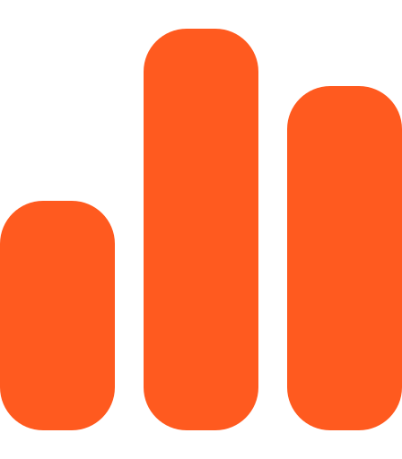&nbsp; GitHub Stats

  
  

  

---

<i>Shipped beats perfect.</i>

<a href="mailto:walidmostafa2077@gmail.com">&nbsp;<b>walidmostafa2077@gmail.com</b></a>
&nbsp;&nbsp;·&nbsp;&nbsp;
<a href="https://walidmoustafa2077.github.io">&nbsp;walidmoustafa2077.github.io</a>

© 2026 Walid Mostafa · C# · .NET · TypeScript · Python

