<!--
  Icons in assets/icons/ are Font Awesome Free 6.7.2 SVG files (CC BY 4.0 — fontawesome.com/license/free),
  recolored to #FF5A1F (accent) and #FF7A3C (accent-2) to match walidmoustafa2077.github.io. Files are named <icon>-accent.svg / <icon>-accent2.svg.
  assets/pipeline.svg is original artwork. Commit the whole assets/ folder next to this README.
-->

  

<a href="https://walidmoustafa2077.github.io">&nbsp;Portfolio</a>
&nbsp;&nbsp;·&nbsp;&nbsp;
<a href="https://github.com/walidmoustafa2077">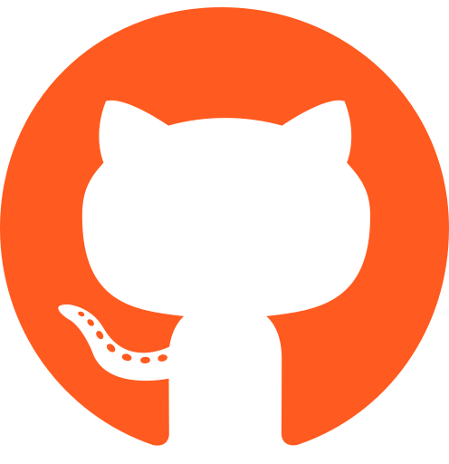&nbsp;GitHub</a>
&nbsp;&nbsp;·&nbsp;&nbsp;
<a href="https://linkedin.com/in/walidmostafa77">&nbsp;LinkedIn</a>
&nbsp;&nbsp;·&nbsp;&nbsp;
<a href="mailto:walidmostafa2077@gmail.com">&nbsp;Email</a>
&nbsp;&nbsp;·&nbsp;&nbsp;
<a href="https://stackoverflow.com/users/walid-mostafa">&nbsp;Stack Overflow</a>

  

<a href="#-about">About</a> &nbsp;·&nbsp;
<a href="#-featured-work">Work</a> &nbsp;·&nbsp;
<a href="#-document-vision-pipeline">Pipeline</a> &nbsp;·&nbsp;
<a href="#-also-building">More</a> &nbsp;·&nbsp;
<a href="#-tech-stack">Stack</a> &nbsp;·&nbsp;
<a href="#-github-stats">Stats</a>

 

## 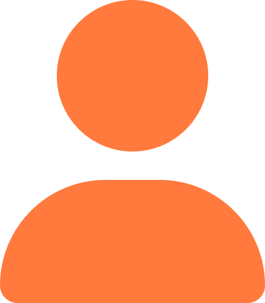&nbsp; About

I build the parts of a product that never make it to the landing page: **auth, payments, migrations, deploys**. Backend first, in C# and Python. I keep scope small enough to finish and tests honest enough to trust, then ship the thing.

> **Shipped beats perfect.**

| | |
|:---|:---|
| 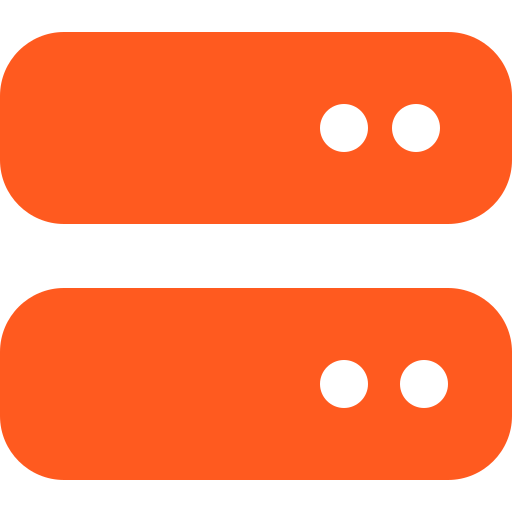&nbsp; **Backend** | C# and Python. ASP.NET Core, .NET 9/10, EF Core, minimal APIs |
| 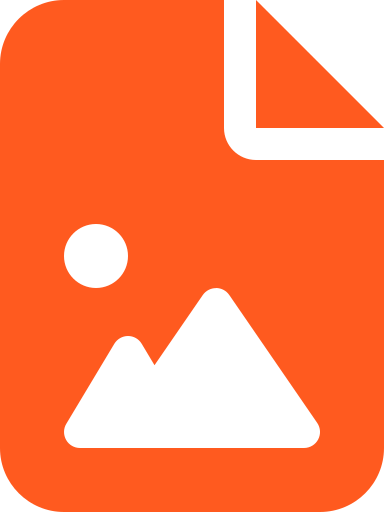&nbsp; **Document Vision** | Corner detection, dewarping, shadow removal, and the synthetic datasets that train them |
| 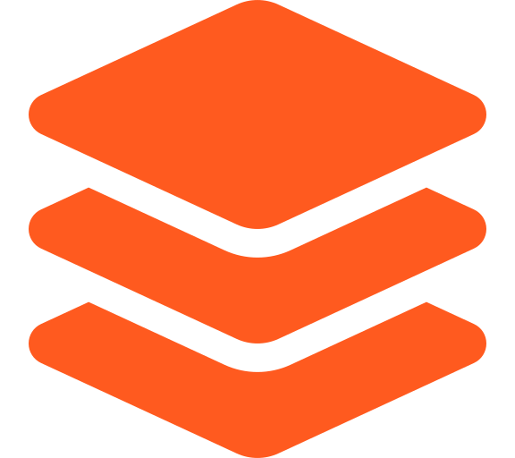&nbsp; **Full stack** | WPF or React/Next.js on the client, Docker and GitHub Actions on the way out |
| 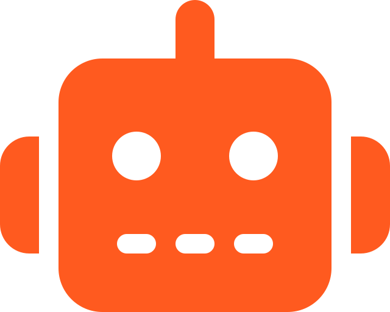&nbsp; **AI-assisted** | The typing got faster. The judgement stayed mine |
| &nbsp; **Learning** | Bachelor's in BIS, plus Microsoft, Meta, and IBM certifications |

 

## 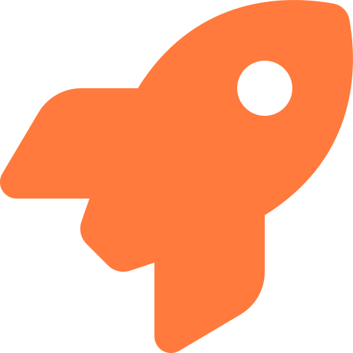&nbsp; Featured Work

<table>
<tr>
<td width="50%" valign="top">

### &nbsp; Document Vision
Small, focused models that turn a **phone photo into a clean scan**: detect → dewarp → remove shadows → export.

`PyTorch` `ONNX` `.NET` `Blender`

[PaperMask](https://github.com/walidmoustafa2077/PaperMask) · [Details below ↓](#-document-vision-pipeline)

</td>
<td width="50%" valign="top">

### &nbsp; Voice Agent
A local phone-call loop you can **interrupt mid-sentence**. Barge-in at ~250 ms, audio never leaves the machine.

`Silero VAD` `Zipformer` `Ollama` `SignalR`

[Source](https://github.com/walidmoustafa2077/voice-agent)

</td>
</tr>
<tr>
<td width="50%" valign="top">

### &nbsp; NexaPOS
Retail point of sale: a **.NET 9 API** (products, sales, carts, inventory) and a **WPF counter client**. JWT auth with Admin, Manager, and Cashier roles.

`ASP.NET Core` `EF Core` `WPF` `MVVM`

Private

</td>
<td width="50%" valign="top">

### 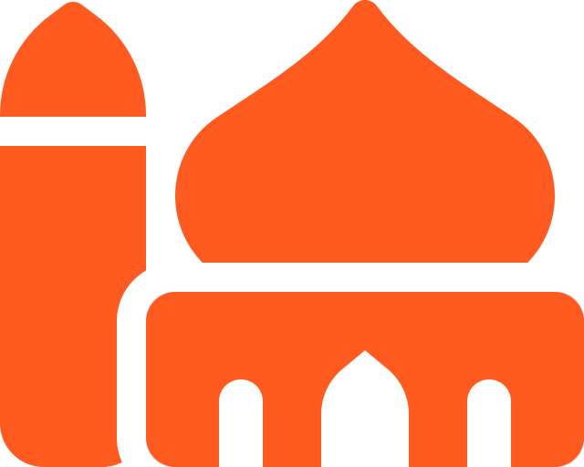&nbsp; Tathkīr
Windows prayer companion: multi-location times, Hijri calendar, tray widget, athkar, and Qur'an with **100+ reciters**. RTL, localization, dynamic theming.

`WPF` `HttpClient` `Docker` `ASP.NET Core`

[Source](https://github.com/walidmoustafa2077/Tathkir)

</td>
</tr>
<tr>
<td colspan="2" valign="top">

### 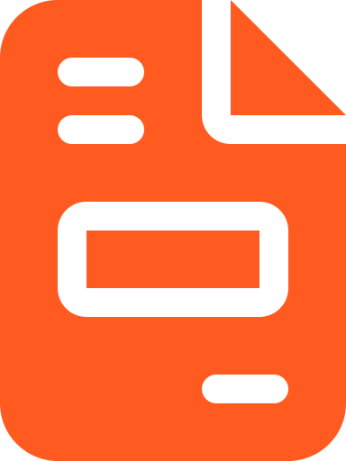&nbsp; NexaCV (private)
Subscription CV builder where the boring parts are the product: **Paddle billing** (checkout, webhooks, customer portal, subscription sync), ATS-friendly exports, a documented design system, and **Playwright** coverage across the Next.js app.

`Next.js` `Paddle` `Playwright`

</td>
</tr>
</table>

 

## 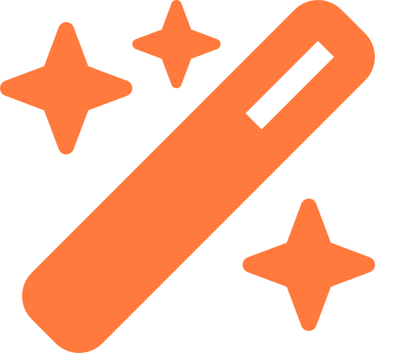&nbsp; Document Vision Pipeline

  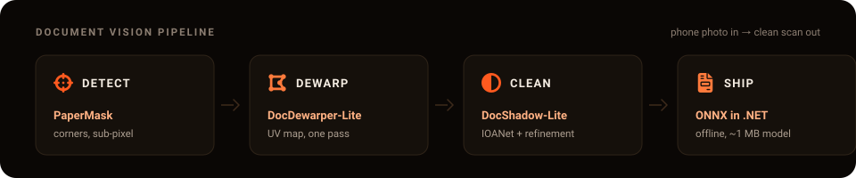

Each stage is a **small model with one job**, exported to ONNX so the .NET app can run it offline. The hard part is never the architecture — it is the data, so the training pipeline is part of the product.

| Stage | Project | What it does |
|:---|:---|:---|
| 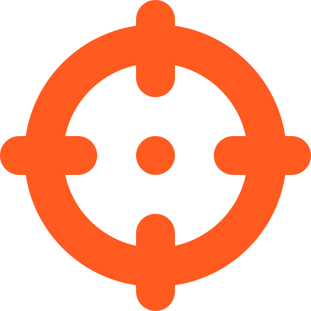&nbsp; **Detect** | [**PaperMask**](https://github.com/walidmoustafa2077/PaperMask) | MobileNetV3-Small + Lite-FPN, heatmap head with sub-pixel offsets, exported to ONNX (~1 MB) for .NET |
| 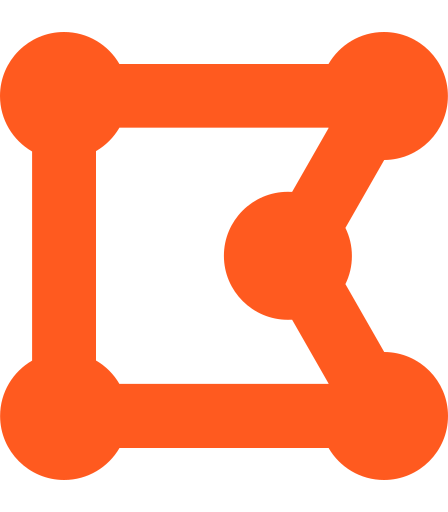&nbsp; **Dewarp** | [**DocDewarper-Lite**](https://github.com/walidmoustafa2077/DocDewarper-Lite) | UVDoc fine-tuned on NexaDoc 50K, with a Kaggle 2×T4 training notebook |
| 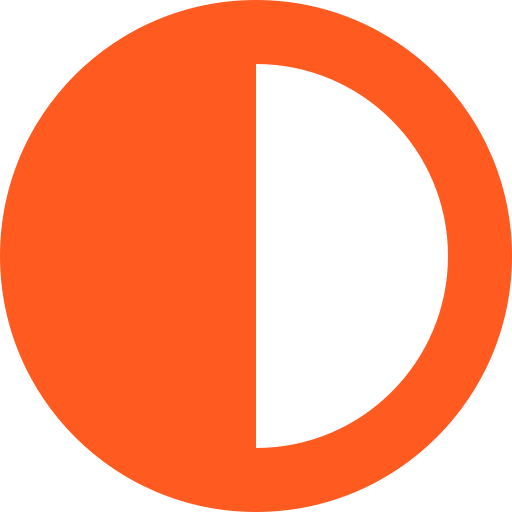&nbsp; **Clean** | [**DocShadow-Lite**](https://github.com/walidmoustafa2077/DocShadow-Lite) | Two-stage shadow removal: IOANet, then Laplacian-pyramid refinement |
| 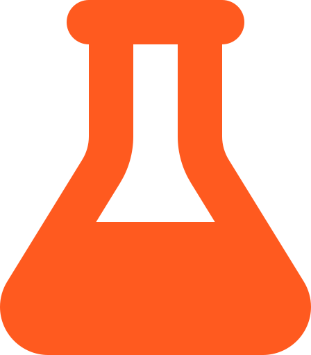&nbsp; **Data** | [**Doc-Dataset-Generate**](https://github.com/walidmoustafa2077/Doc-Dataset-Generate) | SynDoc_Wild: synthetic shadows, camera degradation, perspective warp, plus a photorealistic Blender 4.2 pipeline |
| 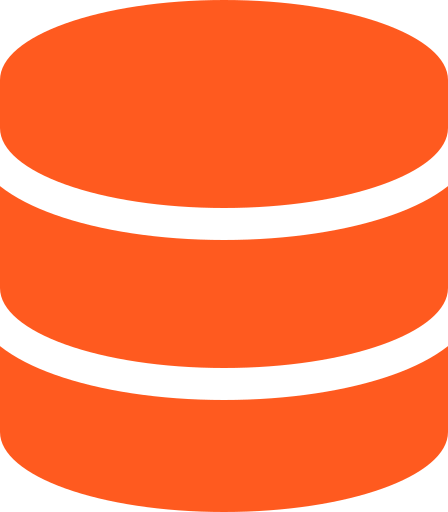&nbsp; **Dataset** | **NexaDoc 50K** | Published on Kaggle, the dataset behind the dewarping work |

 

## &nbsp; Also Building

| Project | Stack | What it is |
|:---|:---|:---|
| [**let-me-code**](https://github.com/walidmoustafa2077/let-me-code) | `Node.js` `MCP` | Agent factory for opencode: specialised subagents, workflow skills, and a delegation MCP server, installed with one command |
| [**termyx**](https://github.com/walidmoustafa2077/termyx) | `Rust` | Native terminal with first-class RTL support |
| [**RecycleBinTray**](https://github.com/walidmoustafa2077/RecycleBinTray) | `C#` `Win32` | Windows tray monitor: live item count and size, open or empty from a native menu |
| [**tasks-lite**](https://github.com/walidmoustafa2077/tasks-lite) | `Node.js` `JWT` | Task API with validation, clean errors, and Swagger docs |
| **store-system** (private) | `ASP.NET Core` `SQL Server` | Retail back office plus public storefront in one codebase: terminal, inventory, shifts, wallets, Paymob checkout |

 

## 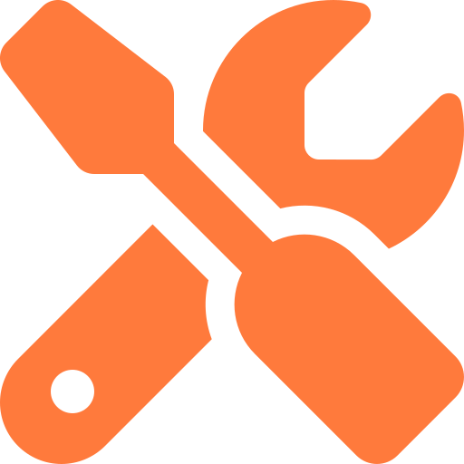&nbsp; Tech Stack

 

<b>Also:</b> EF Core · SQL Server · SignalR · ONNX · Playwright · Ollama · WPF (MVVM)

 

## 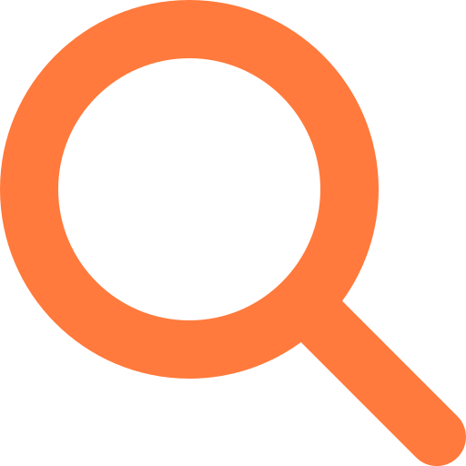&nbsp; Currently Working On

- &nbsp; Closing the document pipeline end to end
- 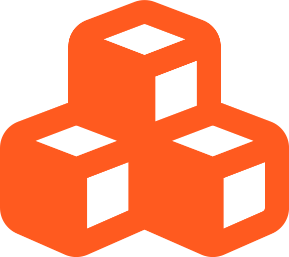&nbsp; Small, local-first tools that keep working after the demo
- 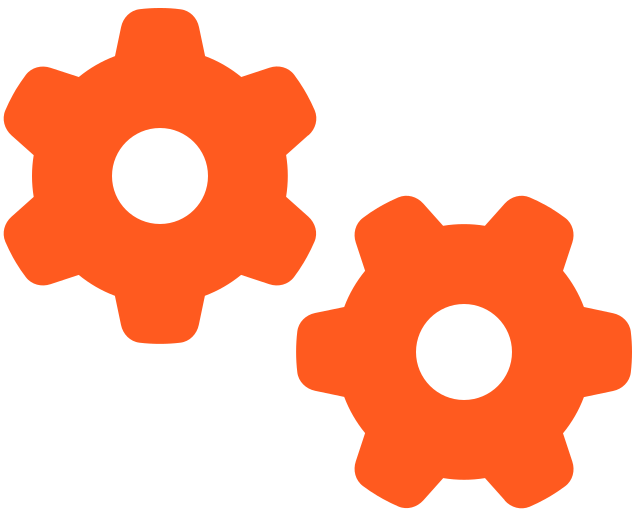&nbsp; Cleaner .NET backends with minimal APIs, EF Core, and honest tests
- &nbsp; Automating builds and releases with GitHub Actions

 

## &nbsp; Certifications

 

## 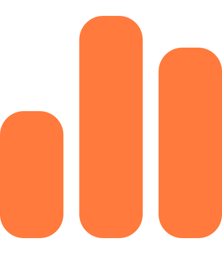&nbsp; GitHub Stats

  

 

<i>"Shipped beats perfect."</i>

  

<a href="mailto:walidmostafa2077@gmail.com">&nbsp;<b>walidmostafa2077@gmail.com</b></a>
&nbsp;&nbsp;·&nbsp;&nbsp;
<a href="https://walidmoustafa2077.github.io">&nbsp;walidmoustafa2077.github.io</a>

  

